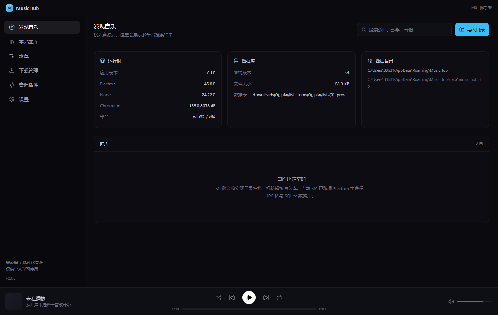

# MusicHub

多平台音乐聚合客户端：本地曲库管理 + 插件化音源（兼容 LX 音源脚本 / MusicFree 插件）。

> 仅供个人学习与研究使用。项目本身不内置任何音源，音源由使用者自行导入。



## 技术栈

| 层 | 选择 |
|---|---|
| 桌面壳 | Electron 45 |
| 构建 | electron-vite 6 + Vite 8 |
| UI | React 19 + TypeScript + Tailwind CSS 4 |
| 数据 | SQLite（better-sqlite3，N-API 预编译）+ Drizzle ORM |
| 打包 | electron-builder 26（NSIS + Portable） |

## 目录结构

```
src/
  main/        Electron 主进程（业务后端）
    db/        SQLite 连接与迁移
    ipc.ts     IPC 处理器注册
    smoke.ts   无人值守冒烟测试
  preload/     contextBridge 安全桥
  renderer/    React 界面
  shared/      主/渲染共用的类型（唯一真源）
```

## 开发

```bash
pnpm install
pnpm dev          # 启动开发窗口（HMR）
pnpm typecheck    # 主进程 + 渲染进程类型检查
pnpm build        # 构建到 out/
pnpm build:win    # 打 Windows 安装包到 release/
pnpm smoke        # 冒烟测试：跑通 IPC + DB 后自动退出
```

### 本机注意事项

1. **不要从 DSH/Electron 派生的终端里启动**：`ELECTRON_RUN_AS_NODE=1` 会让 Electron 变成纯 Node 进程。
   如遇到，先执行 `Remove-Item Env:ELECTRON_RUN_AS_NODE`。
2. 依赖走 npmmirror（见 `.npmrc`），GitHub 直连会因本地代理的证书校验失败。
3. 打包必须保留 `npmRebuild: false`：本机无 MSVC，靠 better-sqlite3 的 N-API 预编译产物。

## 路线图

- [x] M0 脚手架：Electron + React + TS + Tailwind + IPC + SQLite 迁移 + 打包
- [ ] M1 本地曲库：目录扫描、标签解析、列表与播放器内核
- [ ] M2 歌单 CRUD、队列、标签编辑
- [ ] M3 音源沙箱 + 首个音源接入
- [ ] M4 多音源互备 + 插件管理
- [ ] M5 桌面歌词、系统媒体控制、自动更新