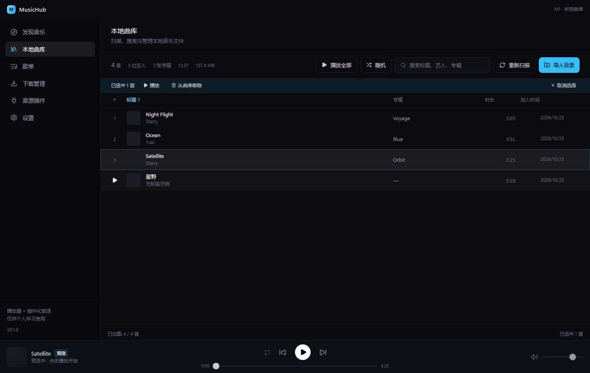

# MusicHub

多平台音乐聚合客户端：本地曲库管理 + 插件化音源（兼容 LX 音源脚本 / MusicFree 插件）。

> 仅供个人学习与研究使用。项目本身不内置任何音源，音源由使用者自行导入。



## 技术栈

| 层 | 选择 |
|---|---|
| 桌面壳 | Electron 45 |
| 构建 | electron-vite 6 + Vite 8 |
| UI | React 19 + TypeScript + Tailwind CSS 4 |
| 数据 | SQLite（better-sqlite3，N-API 预编译）+ Drizzle ORM |
| 打包 | electron-builder 26（NSIS + Portable） |

## 已完成能力（M1）

- 目录导入（可多选）→ 递归扫描 → 标签解析（music-metadata）→ SQLite 入库
- **增量扫描**：按 path + mtime + size 跳过未变更文件（实测二次扫描跳过 5/5）
- 内嵌封面自动提取并按专辑去重缓存；`.lrc` 同名歌词自动关联
- 虚拟滚动曲库列表（万级曲目不掉帧）、关键词搜索、列排序、分页懒加载
- 播放器：队列、上一首/下一首、进度拖拽、音量、顺序/循环/单曲/随机
- `media://` 自定义协议：支持 HTTP Range（可拖动进度）、CORS、媒体元素直连

## 脚本音源沙箱（M4）

- 脚本在 **worker_threads** 中运行，代码经 `vm.createContext` 隔离：没有 `require` / `fs` / `process`
- 只暴露 `fetch`（仅 http/https，拦截 localhost 与内网段）、`URL`、`setTimeout`、`btoa/atob`、`console`
- 单次调用 12 秒超时即**杀掉该音源进程**，不会拖死主进程；脚本崩溃只影响它自己
- 脚本接口（MusicFree 风格）：
  ```js
  module.exports = {
    platform: '我的音源',
    async search(query, page) { /* -> [{ id, title, artist, album, duration, cover }] */ },
    async getMediaSource(track) { /* -> { url } | null */ },
    async getLyric(track) { /* -> { lrc } | string */ }
  }
  ```
- 示例脚本：`resources/example-provider.js`，在「音源插件」页点「导入音源脚本」即可加载

## 搜索与封面

- **多字段模糊搜索**：标题 / 艺人 / 专辑 / **歌词**，空格分词（词元之间 AND，字段之间 OR）
  - 「月夕江」→ 命中歌词含该词的歌；「国风堂 知我」→ 两个词都命中才返回
- **信息在线补全**：本地缺封面 / 缺歌手 / 缺专辑时，按 标题(+艺人) 去音源补，封面下载到 `userData/covers` 并写回库
  - 同一专辑只请求一次，其余曲目直接复用
  - 扫描完成后自动补一批（15 首），也可手动点「补全封面」（一次 30 首）

## 音源（M3）

- 内置音源：**网易云音乐**，匿名可用：搜索、歌词、部分曲目播放地址
- 发现页：选择音源 → 搜索 → 试听（直接播 CDN 地址）→ 下载（写入 `下载目录` 并自动入库）
- **搜索状态常驻**：结果、关键词、滚动位置存在全局 store，切到别的页面再回来不用重搜
- **预览播放**：单击结果行在播放栏预览（不立即播放），双击或点播放键才真正取流播放
- 下载目录默认 `音乐/MusicHub`，可在设置表 `download.dir` 覆盖
- 音源插件页：查看音源状态（最近成功/错误）、启用/禁用
- 本地曲目没歌词时，歌词页会按 标题+艺人 去在线匹配，命中后显示「在线歌词」徽标

> 说明：网易云匿名接口不给 VIP/付费曲目的播放地址，这类曲目会提示「拿不到播放地址」。
> 脚本音源沙箱（LX / MusicFree）尚未实现，见 M4。

## 歌单与队列

- 侧边栏可新建歌单、重命名（歌单页内）、删除；「我喜欢的音乐」是虚拟歌单，映射曲库的收藏标记
- 加歌三种方式：右键「添加到歌单」（含「新建歌单并添加」）、把曲库行拖到左侧歌单名、歌单内批量移除
- 歌单内拖拽行可调整顺序；歌单页支持内部搜索与一键播放全部
- 播放队列面板（底部播放条右侧的列表按钮）：拖动排序、单击跳播、单曲移除、清空
- 队列面板打开时主内容区自动让位，不会遮挡歌单头部按钮

## 歌词页

点击播放栏封面（或右侧麦克风图标）进入全屏歌词页：

- 左侧大封面与曲目信息（格式、码率、时长、大小），背景取自封面模糊图
- 右侧逐行歌词，当前行高亮并自动居中；手动滚动可暂停自动跟随
- 点击任意歌词行跳转到对应时间点（预览态下会先开始播放）
- 支持 `[mm:ss.xx]`、一行多时间标签、`[offset:]` 校正；无时间轴则按纯文本显示
- 歌词来源：同名 `.lrc` 文件优先，其次读标签内嵌歌词（扫描时写入数据库）
- `.lrc` 编码自动识别：UTF-8（含 BOM）、UTF-16LE、GBK/GB18030
- 解析器版本升级后，下次「重新扫描」会自动全量重建索引（跳过缓存），无需手动删库
- `Esc` 收起，`Space` 播放/暂停

## 状态持久化

退出前自动写入 SQLite（`settings` 表），下次启动恢复：

- 音量、静音状态、播放模式（顺序/循环/单曲/随机）
- 播放队列与当前曲目、播放进度（恢复后不自动播放，按播放键从原位置继续）
- 窗口位置与大小（离屏坐标会被忽略）

保存时机：音量/模式/队列变化后 500ms 防抖落盘，暂停时与窗口关闭前再各落一次。

## 交互约定

| 操作 | 行为 |
|---|---|
| 单击行 | 选中（单选），播放栏同步显示该曲目预览（不播放） |
| Ctrl + 单击 | 追加/取消选中（多选） |
| Shift + 单击 | 选中区间 |
| 双击行 | 从该行开始播放 |
| 预览态点播放键 | 播放当前预览的曲目 |
| 右键行 | 原生菜单：播放 / 下一首播放 / 加入队列 / 收藏 / 添加到歌单 / 在文件夹中显示 / 复制路径 / 从曲库移除 |
| 拖动行 | 拖到左侧歌单名即可加入该歌单；在歌单内拖动可排序 |
| 悬停序号 | 变成播放按钮，单击即播 |
| Space | 播放 / 暂停 |
| Enter | 播放选中曲目 |
| ↑ / ↓ | 上下移动选中 |
| Ctrl + A | 全选已加载曲目 |
| Delete | 移除选中曲目（只删记录，不动文件） |
| Esc | 取消选择 |

## 目录结构

```
src/
  main/        Electron 主进程（业务后端）
    db/        SQLite 连接与迁移
    ipc.ts     IPC 处理器注册
    smoke.ts   无人值守冒烟测试
  preload/     contextBridge 安全桥
  renderer/    React 界面
  shared/      主/渲染共用的类型（唯一真源）
```

## 开发

```bash
pnpm install
pnpm dev          # 启动开发窗口（HMR）
pnpm typecheck    # 主进程 + 渲染进程类型检查
pnpm build        # 构建到 out/
pnpm build:win    # 打 Windows 安装包到 release/
pnpm smoke        # 冒烟测试：跑通 IPC + DB 后自动退出
```

### 本机注意事项

1. **不要从 DSH/Electron 派生的终端里启动**：`ELECTRON_RUN_AS_NODE=1` 会让 Electron 变成纯 Node 进程。
   如遇到，先执行 `Remove-Item Env:ELECTRON_RUN_AS_NODE`。
2. 依赖走 npmmirror（见 `.npmrc`），GitHub 直连会因本地代理的证书校验失败。
3. 打包必须保留 `npmRebuild: false`：本机无 MSVC，靠 better-sqlite3 的 N-API 预编译产物。

## 路线图

- [x] M0 脚手架：Electron + React + TS + Tailwind + IPC + SQLite 迁移 + 打包
- [x] M1 本地曲库：目录扫描、标签解析、虚拟滚动列表、播放器内核、media:// 音频协议
- [x] M2 歌单 CRUD、播放队列、拖拽入歌单
- [x] M3 首个音源接入（网易云：搜索 / 试听 / 下载 / 歌词 / 在线歌词兜底）
- [x] M4 脚本音源沙箱（worker + 受限 vm，支持导入自定义音源脚本）
- [ ] M5 多音源互备、桌面歌词、自动更新
- [ ] M5 桌面歌词、系统媒体控制、自动更新