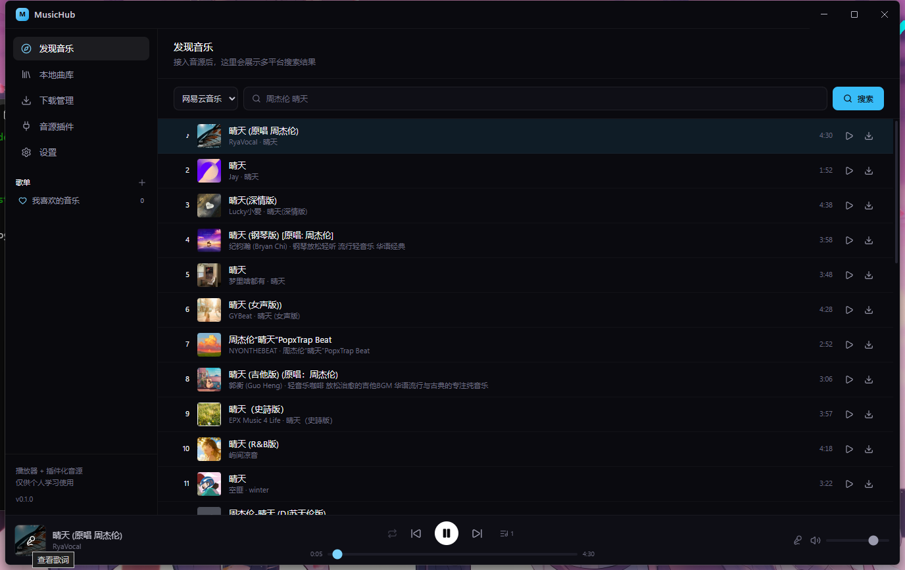
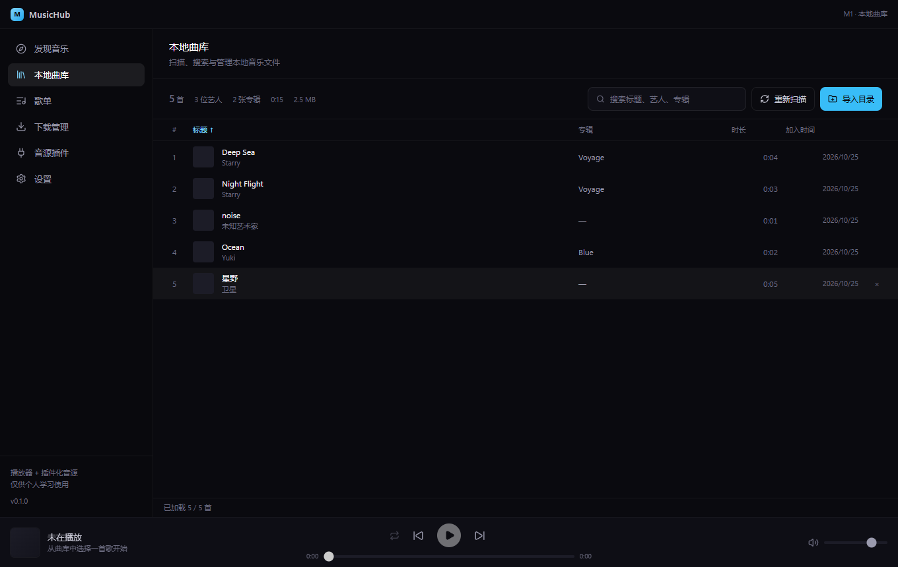
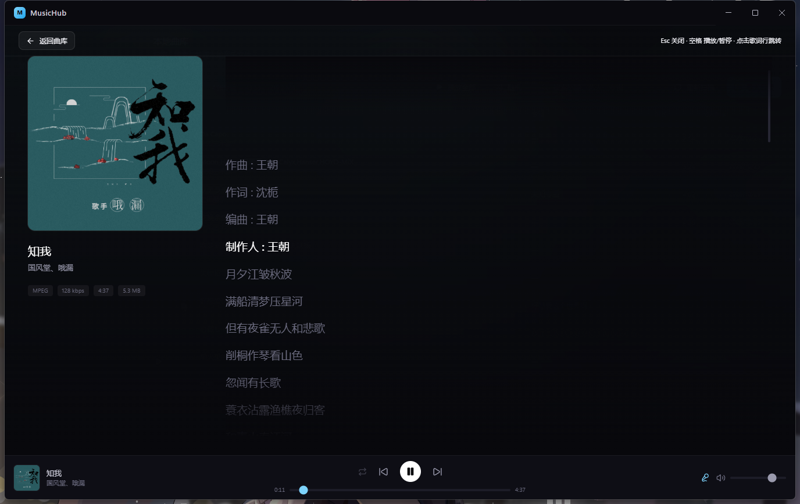
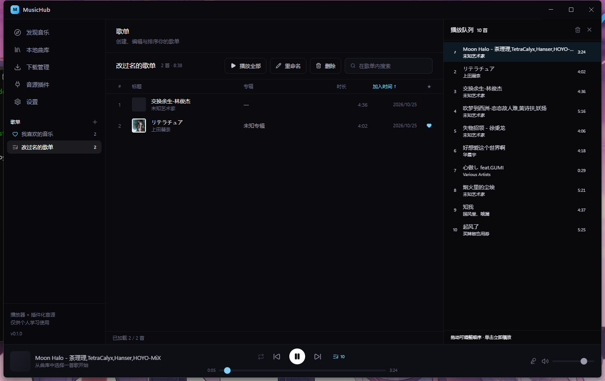

# MusicHub

> 一个 Windows 桌面音乐播放器：把**本地曲库**和**多平台在线音源**放进同一个界面，统一搜索、播放、收藏、下载。

`v1.0.0` · `GPL-3.0` · `Windows` · `Electron 45`

---

## 目录

- [项目简介](#项目简介)
- [功能特性](#功能特性)
- [界面与操作](#界面与操作)
- [快速开始](#快速开始)
- [音源插件体系](#音源插件体系)
- [技术架构](#技术架构)
- [数据与隐私](#数据与隐私)
- [已知限制](#已知限制)
- [版权与许可](#版权与许可)
- [风险提示与免责声明](#风险提示与免责声明)
- [参与贡献](#参与贡献)

---

## 项目简介

MusicHub 是一个用 Electron + React 编写的桌面音乐客户端。它要解决的问题是：

**你收藏的音乐散落在本地文件夹、网易云、QQ 音乐等不同地方，没有一个统一入口。**

MusicHub 把这些地方聚合到一个应用里：

- **本地文件**：扫描已有的 MP3 / FLAC，读标签、封面、歌词，入库后支持全文模糊搜索
- **在线音源**：通过「音源插件」接入不同平台，搜索结果可预览、播放、收藏、下载
- **两者混排**：在线歌曲收藏后进入「我喜欢的音乐」，与本地歌曲在同一个列表里管理
- **平台歌单**：把网易云 / QQ 音乐的歌单导入成自己的歌单，直接在这里播放

音源实现**不写死在程序里**，而是外部 JS 插件。平台改版或新增平台时，只需更新插件，不必重新发布主程序。

### 界面预览

| 发现音乐（多音源搜索） | 本地曲库 |
|---|---|
|  |  |

| 歌词页 | 歌单 |
|---|---|
|  |  |

---

## 功能特性

### 本地曲库

- 扫描指定文件夹，递归读取 `MP3 / FLAC / M4A / OGG / WAV` 等常见格式
- 标签解析：标题、艺术家、专辑、音轨号、年份、码率、时长
- 封面：优先内嵌封面，其次同名图片（`歌名.jpg` / `cover.jpg` / `folder.jpg`）
- 歌词：内嵌歌词与同名 `.lrc`，自动识别 GBK / UTF-16 等编码
- **模糊搜索**：歌名、艺术家、专辑、歌词全文，多关键词空格分隔（AND 关系）
- 增量扫描：文件未变化则跳过；解析器升级时自动重解析
- 在线补全：缺失的封面、艺术家、专辑可按需联网补全

### 播放器

- 底部播放栏：封面、可拖动进度条、音量、播放模式（顺序 / 单曲 / 随机）
- **单击预览、双击播放**：单击只选中并在播放栏显示，不打断当前播放
- 队列面板：查看待播列表并跳转
- 歌词页：点击底部封面进入，逐行居中高亮滚动，支持在线歌词
- 播放状态持久化：重启后恢复上次音量与播放模式

### 在线音源

- **多音源并行搜索**：一次查询同时请求所有已启用音源，结果交错合并，每行标注来源
- **单源失败不影响整体**：某个音源异常时只有它标红，其它照常出结果
- **播放换源兜底**：本源拿不到地址时，自动到其它音源按「标题 + 艺术家」找同一首
- **在线预览**：搜索结果可直接试听，无需先下载
- **在线收藏**：搜索结果点 ♥ 直接进入「我喜欢的音乐」
- **账号登录**：打开平台官方登录页（账密 / 验证码 / 扫码都在官方页面完成），登录后可用私人歌单与更高音质

### 歌单

- 自建歌单：新建、重命名、删除、拖拽排序、移出、歌单内搜索
- 「我喜欢的音乐」：本地与在线歌曲混排，列表内直接点 ♥ 切换
- **平台歌单导入**：填写平台账号或歌单 ID，拉取公开 / 私人歌单导入为本地歌单
- 右键菜单：播放、下一首播放、加入歌单、下载到本地、移出、收藏
- `Ctrl + 单击` 多选批量操作

### 下载

- 任务队列（并发 2），实时进度与已下载大小
- 支持取消、重试、打开所在文件夹、清空已完成
- **下载前风险确认弹窗**（批量下载会显示数量）
- 下载时**一并保存封面**（同名图片），入库后自动识别
- 自定义下载目录（设置页可手输路径或选择文件夹）
- 任务与历史持久化，重启后仍可见

### 音源插件

- 插件是独立 `.js` 文件，运行时加载，不受主程序版本限制
- 内置沙箱：独立 `worker_threads` + `vm`，插件拿不到 `require` / `fs` / `process`
- 协议 v2：`ctx` 提供请求、cookie 管理、加密原语、登录态、日志
- 随包插件自动安装，并按内容比对自动更新
- 支持导入第三方插件（MusicFree 风格脚本可适配）

### 设置

- 下载目录：选择文件夹 / 手动输入 / 打开 / 恢复默认

---

## 界面与操作

### 发现音乐

1. 音源下拉选择平台，或选 **「全部音源」** 同时搜索
2. 输入关键词回车；顶部状态条显示各音源命中数量（失败会标红）
3. 鼠标移到结果行 → 播放 / 收藏 / 下载
4. 已登录的账号会在音源旁显示 `已登录 xxx`

### 本地曲库

- 「导入目录」选择文件夹 → 自动扫描入库
- 「重新扫描」增量更新；「补全信息」联网补封面 / 艺术家 / 专辑
- 顶部显示曲目数、艺术家数、专辑数、总时长、总大小
- 单击选中（底部播放栏同步），双击播放；行尾 ♥ 收藏

### 歌单

- 侧边栏「歌单」右侧 `+` 新建，⬇ 打开平台歌单导入
- 歌单行悬停显示 ✏️（重命名）与 🗑（删除）
- 歌单内：拖动行排序、右键更多操作、顶部搜索框过滤

### 歌词

点击底部播放栏封面进入歌词页；本地歌词优先，缺失时自动查找在线歌词（右上角有「在线」标识）。

### 下载管理

列出所有下载任务；进行中可取消，失败可重试，完成后可打开所在文件夹。

---

## 快速开始

### 环境要求

- Windows 10 / 11（x64）
- 源码运行需要 Node.js ≥ 20.19、pnpm 10+

### 从源码运行

```bash
git clone https://github.com/<你的用户名>/music-hub.git
cd music-hub
pnpm install

# 首次需要先拉取音源插件（见「音源插件体系」）
pnpm sync:providers

pnpm dev
```

### 打包

```bash
pnpm build:win     # 生成 NSIS 安装包 + 便携版
```

> 国内网络建议先设置 Electron 镜像：
> `$env:ELECTRON_MIRROR='https://npmmirror.com/mirrors/electron/'`

---

## 音源插件体系

音源实现**不在本仓库**，而在独立仓库 **music-hub-providers**。

本仓库的 `resources/providers/` 由同步脚本填充：

```bash
pnpm sync:providers   # pnpm dev / pnpm build 会自动执行
```

查找顺序：环境变量 `MUSIC_HUB_PROVIDERS_DIR` → `providers.lock.json` 的 `repo` / `ref` → 同级目录 `../music-hub-providers` → 已有的 `resources/providers`。

打包时插件通过 `extraResources` 进入安装包的 `resources/providers`，首次启动复制到用户目录并随版本自动更新。

想自己写插件？见插件仓库的开发指南。

---

## 技术架构

| 层 | 选型 |
|---|---|
| 桌面框架 | Electron 45（Node 24 / Chromium 156） |
| 构建 | electron-vite 6 + Vite 8 |
| 界面 | React 19 + TypeScript 5.9 + Tailwind CSS 4 |
| 状态 | Zustand |
| 数据库 | SQLite（better-sqlite3），基于 `user_version` 的迁移 |
| 标签解析 | music-metadata |
| 打包 | electron-builder（NSIS + Portable） |

### 进程与安全边界

```
主进程 (Node)        数据库 / 文件 / 网络 / 下载 / 登录窗口
   ↕ IPC (contextBridge)
渲染进程 (Chromium)   React 界面，无 Node 权限
   ↕ worker + vm
插件 worker           音源脚本，无 require / fs / process
```

- 媒体文件通过自定义 `media://` 协议提供，支持 Range 请求（可拖动进度条）
- 插件请求强制 http/https，内网地址被拦截，单次调用 12 秒超时
- 登录凭据用 Electron `safeStorage`（Windows DPAPI）加密后入库

### 目录结构

```
src/
  main/       主进程：数据库、扫描、媒体协议、音源注册、登录、下载
  preload/    IPC 桥
  renderer/   React 界面
  shared/     主进程与界面共用的类型
resources/    插件目录（由 sync 脚本填充，不进版本管理）
docs/         截图与设计文档
scripts/      构建辅助脚本
```

---

## 数据与隐私

- **所有数据只存本机**：数据库、封面缓存、下载文件都在你的机器上
- 默认位置：`%APPDATA%\MusicHub`（数据库与封面）、`%USERPROFILE%\Music\MusicHub`（下载）
- **不收集任何遥测**，不向作者服务器发送任何数据
- 网络请求只发生在：音源搜索 / 播放 / 歌词、平台登录页、封面补全、你主动触发的下载
- 登录凭据仅保存该平台必需的 cookie，加密存储，只有对应插件的沙箱进程可读取

---

## 已知限制

| 限制 | 说明 |
|---|---|
| 仅支持 Windows | 未适配 macOS / Linux |
| VIP 曲目取决于账号 | 未登录或账号无会员时拿不到播放地址，界面会明确提示 |
| QQ「我喜欢」需从列表导入 | 直接填 `201` 无效，请点导入面板列表里的「我喜欢」 |
| 酷狗仅支持搜索 | 播放需要平台签名算法，且暂无封面 |
| 无多设备同步 | 数据仅在本机 |

---

## 版权与许可

本项目使用 **GNU General Public License v3.0** 发布，全文见 [LICENSE](LICENSE)。

### 这意味着什么

- ✅ 可自由使用、修改、分发，包括商业用途
- ✅ 可集成进你自己的软件
- ⚠️ **但必须开源**：分发修改后的版本（或并入其它程序）时，必须以 GPL-3.0 公开源代码
- ⚠️ 必须保留版权声明与许可声明
- ❌ 不提供任何担保

### 第三方组件与来源

| 组件 | 许可 / 来源 |
|---|---|
| Electron / React / Vite 等依赖 | 各自的开源许可，见 `package.json` |
| 音源插件 | 独立仓库，同为 GPL-3.0 |
| 平台登录能力 | 使用各平台**官方登录页面**，不破解登录协议 |

> 本仓库不包含任何平台的逆向签名代码；此类代码位于插件仓库的 `providers/lib/`，并在该仓库单独说明来源与适用范围。

---

## 风险提示与免责声明

**请在使用前完整阅读本节。**

### 1. 版权风险

- 本项目**不提供、不托管、不分发任何音乐内容**，只提供访问公开接口的技术能力
- 下载的音乐文件属于**你的个人行为**，请确保你拥有相应使用权
- **严禁**将下载内容用于商业分发、二次传播或任何侵犯著作权的用途
- 下载前的风险确认弹窗是提示，不是授权

### 2. 账号风险

- 使用登录态访问平台接口可能触发风控，**存在账号被限制甚至封禁的风险**
- 请勿使用主账号，避免高频请求
- 登录 cookie 保存在本机，但**能运行在你电脑上的程序都可能读取它**，请注意设备安全

### 3. 平台与接口风险

- 各平台接口可能随时变更，导致音源失效；这是此类工具的固有情况
- 本项目不承诺任何音源的长期可用性

### 4. 合规风险

- 各地对音乐缓存、下载、格式转换的法律规定不同，**请自行确认所在地法律**
- 因使用本软件产生的一切后果由使用者自行承担

### 5. 免责声明

> 本项目仅供**个人学习与研究**使用。作者不对因使用本软件造成的任何直接或间接损失负责，包括但不限于账号封禁、数据丢失、法律纠纷。若不同意上述条款，请立即停止使用并删除本软件。

---

## 参与贡献

- 主程序问题：在本仓库提 Issue / PR
- **音源插件**（新增平台、修复平台接口）：请到 **music-hub-providers** 仓库
- 提交 PR 前请确保 `pnpm typecheck` 通过

---

## 致谢

- [Electron](https://www.electronjs.org/) / [React](https://react.dev/) / [Vite](https://vite.dev/)
- [music-metadata](https://github.com/Borewit/music-metadata)：标签与封面解析
- 所有提交 Issue 与 PR 的贡献者
